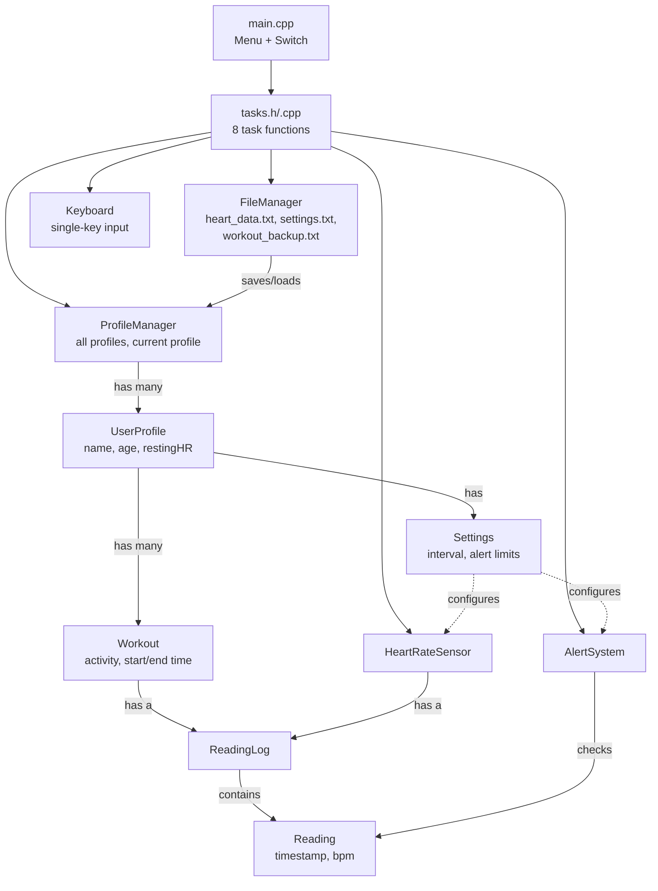

# Iteration #2: System Design

This iteration covers the design of the heart rate tracker: how a session runs, what the menu offers, which classes make up the system, how the code is split across files, and who worked on what.

> **Revised design.** After reviewing the original Iteration 2 report, the design was updated to support multiple profiles that can be managed and each have their own settings, workout history, automatic real-time readings, live alerts, automatic saving with a workout backup for crash recovery, and standard heart rate zones. See [Design Decisions](#7-design-decisions) for what changed and why, [Future Work](#8-future-work) for planned features, and [Open Questions](#9-open-questions) for what is still undecided.

## Contents

1. [How the Program Works](#1-how-the-program-works)
2. [Menu](#2-menu)
3. [Architecture Overview](#3-architecture-overview)
4. [Classes](#4-classes)
5. [Data Files](#5-data-files)
6. [File Structure](#6-file-structure)
7. [Design Decisions](#7-design-decisions)
8. [Future Work](#8-future-work)
9. [Open Questions](#9-open-questions)
10. [Contributions](#10-contributions)

---

## 1. How the Program Works

A typical session goes through these steps:

1. **Start up.** The program automatically loads all profiles and workouts from the [data file](#profile-and-workout-data) and each profile's settings from the [settings file](#settings-file). If a file is missing, it starts empty or uses the default settings. If it finds a [workout backup](#recovering-an-unfinished-workout) left by a workout that never finished, it asks the user whether to continue that workout.
2. **Sign in.** The user creates a new `UserProfile` (Name, Age, Resting HR) or switches to an existing one. Every profile name must be unique. From the same menu, profiles can also be renamed or deleted. This menu is available any time no workout is running.
3. **Start a workout.** A profile is required. The user types an **activity** label for the workout (any text, e.g. "Swim", "Run", "Jog"), and a new `Workout` begins for the current profile.
4. **Track heart rate.** The `HeartRateSensor` takes a reading **automatically** at the interval in the current profile's settings (5 seconds by default). Pressing **Enter** takes a reading immediately. Each `Reading` is stamped with the real time it was taken and checked by the `AlertSystem`, and any alert is shown immediately. The workout so far is copied to a **backup file** at a regular interval (every 30 seconds by default).
5. **Stop.** The user presses **q** or **Space**. No Enter is needed. The readings are saved into the `Workout`, which is added to the profile's workout history and **saved to the files automatically**. The backup file is then deleted, and a summary is shown.
6. **Review.** From the menu the user can view their history, statistics, time in each heart rate zone, and alerts.

### Workout loop

The workout runs in a loop that never waits for input, so automatic readings keep coming while the program watches for key presses:

```text
set up the sensor and alerts from the current profile's settings
start the sensor and switch the keyboard to single-key mode
note the time the loop started (used to count active time)
while the sensor is running:
    if the reading interval has passed since the last reading:
        take a reading, show it, check it for alerts
    if a key was pressed:
        Enter     -> take a reading now (the next automatic one comes a full interval later)
        q / Space -> stop the sensor
    if the backup interval has passed since the last backup:
        write the workout so far, including its active time, to the backup file
    pause briefly (about 50 ms) so the loop doesn't use 100% CPU
switch the keyboard back to normal mode
add the time since the loop started to the workout's active time
store the readings in a new Workout on the current profile
save all data to the files
delete the backup file
```

The backup file is deleted only **after** the workout has been saved to `heart_data.txt`, so the readings are always in at least one of the two files.

A workout's **duration** counts only the time the workout loop was actually running (its _active time_). Time when the program was closed, for example between an interruption and [continuing the workout](#recovering-an-unfinished-workout), is left out.

### Recovering an unfinished workout

If the program crashes or the window is closed during a workout, the backup file stays behind. At the next start-up, after loading the data, the program finds it and shows what it contains:

```text
An unfinished workout was found:
  Profile: Alex   Activity: Morning Run
  Started: 2026-10-27 09:15   Readings: 42 (last at 09:19)
1. Continue the workout
2. Save it as a finished workout
3. Discard it
```

- **1. Continue:** signs in to that profile and restarts the [workout loop](#workout-loop) with the same activity, start time, readings, and active time. New readings are added after the old ones, and active time keeps counting from where the backup left off. The time the program was closed is not counted.
- **2. Save as finished:** adds the workout to the profile's history, ending at the time of its last reading, with the active time from the backup, and saves it.
- **3. Discard:** deletes the backup.

Two special cases:

- **The profile no longer exists** (e.g. the data file was edited by hand): the workout can't be continued or saved, so the user can only discard it.
- **The workout is already in the profile's history** (same start time): the program stopped after saving the workout but before deleting the backup. The backup is out of date, so it is deleted without asking.

## 2. Menu

`main()` shows the menu, reads the user's choice, and uses a `switch` with one case per option. Each case calls a single task function.

| Option | Action               | Function               | Needs a profile? |
| :----: | -------------------- | ---------------------- | :--------------: |
|   1    | Manage profiles      | `taskManageProfiles()` |        No        |
|   2    | Start workout        | `taskRunWorkout()`     |       Yes        |
|   3    | View latest readings | `taskViewLatest()`     |       Yes        |
|   4    | Load data            | `taskLoad()`           |        No        |
|   5    | View workout history | `taskViewHistory()`    |       Yes        |
|   6    | Statistics           | `taskStatistics()`     |       Yes        |
|   7    | Heart rate zones     | `taskZoneSummary()`    |       Yes        |
|   8    | Alerts               | `taskAlerts()`         |       Yes        |
|   0    | Exit                 | —                      |        No        |

Options 1–4 handle **data** (profiles, workouts, loading). Options 5–8 handle **analysis** (history, statistics, zones, alerts). There is no Save option, because everything is [saved automatically](#7-design-decisions). A **Settings** option is planned for later (see [Future Work](#8-future-work)).

### Option details

- **1. Manage profiles:** Lists the existing profiles and opens a small sub-menu (see [Managing profiles](#managing-profiles)).
- **2. Start workout:** Asks for an activity label, then runs the [workout loop](#workout-loop), backing up the workout as it goes. When it finishes, it saves automatically and shows the average BPM, the average of the last 30 seconds, and the average of the last 5 readings.
- **3. View latest readings:** Shows the last few readings of the current profile's most recent workout.
- **4. Load data:** Reloads everything from the files, **replacing** what is in memory. Data already loads automatically at start-up, so this is only needed after editing the files by hand while the program is running.
- **5. View workout history:** Lists the current profile's workouts with the date, activity, duration (active time), and average BPM of each.
- **6. Statistics:** Shows the minimum, maximum, and average BPM for the latest workout and for all of the profile's workouts.
- **7. Heart rate zones:** Shows how many readings fall in each [heart rate zone](#heart-rate-zones).
- **8. Alerts:** Lists every reading in the profile's history that was outside the profile's [alert limits](#alert-limits).
- **0. Exit:** Closes the program. Nothing is lost, because every change has already been saved.

### Managing profiles

Option 1 opens this sub-menu. Every change is **saved to the files immediately**.

| Choice | Action         | Details                                                                                                                                                         |
| :----: | -------------- | --------------------------------------------------------------------------------------------------------------------------------------------------------------- |
|   1    | Create profile | Asks for Name, Age, and Resting HR, then signs in to the new profile. It starts with the default settings. If the name is taken, the user is asked for another. |
|   2    | Switch profile | Signs in to an existing profile.                                                                                                                                |
|   3    | Rename profile | Changes a profile's name. The new name must be unique. Its workouts and settings stay with it.                                                                  |
|   4    | Delete profile | Asks for confirmation (y/n), then removes the profile, its workouts, and its settings. Deleting the signed-in profile signs the user out.                       |
|   0    | Back           | Returns to the main menu.                                                                                                                                       |

Whenever the signed-in profile changes (switching, or deleting the current profile), the sensor's `ReadingLog` is **cleared** so no readings carry over from one profile to another. Since the menu can't be reached while a workout is running, a workout always has to be stopped first.

## 3. Architecture Overview



- `main.cpp` loads all data through the `FileManager` at start-up, offers to recover any unfinished workout, shows the menu, and passes control to the **task functions**.
- The `ProfileManager` holds every `UserProfile`, makes sure names are unique, handles creating, renaming, and deleting profiles, and knows which profile is signed in.
- Each `UserProfile` has its own **`Settings`** (reading interval, alert limits, abnormal reading chance) and a **history of `Workout`s**. Each `Workout` has a `ReadingLog` of its readings.
- Before a workout, the sensor and the alert system are set up from the current profile's settings.
- During a workout, the `HeartRateSensor` fills its own `ReadingLog`, which other classes can read. When the workout ends, those readings are stored in the `Workout`. The sensor's log is cleared whenever a workout starts or the signed-in profile changes.
- The `AlertSystem` checks each `Reading` live during a workout, and can also scan a whole log afterwards.
- `Keyboard` lets the workout loop notice single key presses (Enter, q, Space) without stopping to wait for input.
- The `FileManager` reads and writes both files. It saves after every workout and every profile change.

## 4. Classes

### Summary

| Class             | Role                                                                                               |
| ----------------- | -------------------------------------------------------------------------------------------------- |
| `ProfileManager`  | Holds all profiles, keeps names unique, creates/renames/deletes profiles, tracks the signed-in one |
| `UserProfile`     | The person wearing the tracker, with their settings and workout history                            |
| `Settings`        | One profile's adjustable values (reading interval, alert limits, abnormal reading chance)          |
| `Workout`         | One exercise session: activity label, start/end time, readings                                     |
| `Reading`         | A single heart rate reading (timestamp, bpm)                                                       |
| `ReadingLog`      | An ordered list of readings, with statistics                                                       |
| `HeartRateSensor` | Produces readings in real time (simulated for now)                                                 |
| `AlertSystem`     | Checks readings against safe limits                                                                |
| `FileManager`     | Saves and loads the data file and the settings file                                                |
| `Keyboard`        | Single-key input that doesn't wait (helper for the workout loop)                                   |

### `ProfileManager`

Holds every profile and tracks which one is signed in.

- **Private:** `vector<UserProfile> profiles`, `int currentIndex` (−1 when nobody is signed in), `Settings defaults` (given to new profiles)
- **Public:**
  - `createProfile(name, age, restingHR)`: adds a profile with the default settings and signs in to it. Returns `false` if the name is already taken.
  - `renameProfile(index, newName)`: returns `false` if the new name is already taken
  - `deleteProfile(index)`: removes the profile with its workouts and settings. If it was the signed-in profile, nobody is signed in afterwards.
  - `nameExists(name)`: compares names ignoring upper/lower case and spaces at either end, so "Alex" and "alex " count as the same name
  - `selectProfile(index)`: switches to an existing profile
  - `hasCurrent()`, `getCurrent()`
  - `getProfiles()`, `count()`
  - `getDefaults()`, `setDefaults(Settings)`
  - `printList()`

### `UserProfile`

The person wearing the tracker, with their settings and history of workouts.

- **Private:** `string name` (unique), `int age`, `int restingHR`, `Settings settings`, `vector<Workout> workouts`
- **Public:**
  - `setProfile(name, age, restingHR)`, `setName(name)`
  - `getName()`, `getAge()`, `getRestingHR()`
  - `getSettings()`, `setSettings(Settings)`
  - `getMaxHR()`: returns 220 − age
  - `getZoneNumber(bpm)`: returns 0–6 (see [Heart Rate Zones](#heart-rate-zones))
  - `getZoneName(zone)`
  - `addWorkout(Workout)`, `getWorkouts()`, `getLatestWorkout()`, `hasWorkouts()`
  - `print()`

Resting HR is entered by the user when the profile is created.

### `Settings`

One profile's adjustable values. Users will later change them from a settings menu. Until then they are changed by editing the [settings file](#settings-file), and adding the menu only needs the `set…()` calls and a save.

- **Private:** `int readingIntervalSeconds`, `int alertLowBpm`, `int alertHighBpm` (0 means "use the user's max HR"), `int abnormalReadingPercent`, `int backupIntervalSeconds`
- **Public:**
  - `getReadingInterval()`, `getAlertLow()`, `getAlertHigh()`, `getAbnormalPercent()`, `getBackupInterval()`
  - `setReadingInterval(seconds)`, `setAlertLow(bpm)`, `setAlertHigh(bpm)`, `setAbnormalPercent(percent)`, `setBackupInterval(seconds)`
  - `setValue(key, text)`: sets one value from a `key=value` line in the settings file. Returns `false` for an unknown key or an invalid value, which keeps the current value.
  - `print()`

| Setting                    | Default | Meaning                                                                      |
| -------------------------- | :-----: | ---------------------------------------------------------------------------- |
| `reading_interval_seconds` |    5    | Time between automatic readings                                              |
| `alert_low_bpm`            |   40    | A reading below this is an alert                                             |
| `alert_high_bpm`           |   max   | A reading above this is an alert. `max` means the user's max HR (220 − age). |
| `abnormal_reading_percent` |    2    | Chance (in %) that the simulator produces an abnormal reading                |
| `backup_interval_seconds`  |   30    | Time between workout backups                                                 |

### `Workout`

One exercise session, linked to the profile that recorded it.

- **Private:** `string activity` (any label the user types, e.g. "Swim"), `time_t startTime`, `time_t endTime`, `int activeSeconds` (time the workout was actually running), `ReadingLog readings`
- **Public:**
  - `getActivity()`, `getStartTime()`, `getEndTime()`
  - `getDurationSeconds()`: returns `activeSeconds`, not end time − start time, so time when the program was closed doesn't count
  - `addActiveSeconds(seconds)`: used by the workout loop
  - `getReadings()`
  - `printSummary()`: date, activity, duration, average BPM

### `Reading`

A single heart rate reading.

- **Private:** `time_t timestamp` (the real time it was taken), `int bpm`
- **Public:** `getTimestamp()`, `getBpm()`, `print()`

The activity is stored once on the `Workout` instead of on every reading.

### `ReadingLog`

An ordered list of readings, with the statistics calculations.

- **Private:** `vector<Reading> readings`
- **Public:**
  - `add(Reading)`, `get(index)`, `size()`, `clear()`
  - `minBpm()`, `maxBpm()`, `avgBpm()`
  - `avgLast(n)`: average of the last _n_ readings
  - `avgSince(seconds)`: average of the readings taken in the last _seconds_ seconds
  - `print()`, `printLast(n)`

### `HeartRateSensor`

Produces heart rate readings in real time. For now the BPM values are **simulated**. Later they could come from a data file or a real sensor without changing the rest of the system.

- **Private:** `ReadingLog readings` (the current workout's readings), `bool running`, `time_t lastReadingTime`, `int intervalSeconds`, `int abnormalPercent`, `int lowLimit`, `int highLimit`, `int currentBpm` (the simulator's last normal value)
- **Public:**
  - `configure(const UserProfile&)`: takes the interval, abnormal chance, and limits from the profile's settings, and the starting BPM from its resting HR
  - `start()`: clears the log and starts the sensor
  - `resume(const ReadingLog&)`: starts the sensor with the readings of a [recovered workout](#recovering-an-unfinished-workout). The simulation continues from the last reading's BPM.
  - `stop()`, `isRunning()`
  - `isReadingDue()`: true when the interval has passed since the last reading
  - `takeReading()`: creates a `Reading` with the current time and a BPM value, adds it to the log, and returns it
  - `clear()`: empties the log (used when the signed-in profile changes)
  - `getReadings()`: read-only access to the log
  - `getAverageBPM()`
  - `getRecentAverageBPMFrom(float seconds)`: average over the last _seconds_ of real time
  - `getLastAverageBPM(int numberOfRecentReadings)`

**How the simulation works:**

- **Normal readings:** the BPM starts near the user's resting HR and moves up or down by a few BPM at each reading, staying between the alert limits. Readings that change gradually like this make the "last 30 seconds" average meaningful.
- **Abnormal readings:** on rare occasions (`abnormal_reading_percent`, 2% by default) the sensor produces a value just outside the alert limits, either too low or too high. These spikes test the alert system. The next reading goes back to the normal drift.
- **Testing alerts:** set a profile's `abnormal_reading_percent` to a high value such as 50 to make alerts appear quickly.

### `AlertSystem`

Checks readings against safe limits. During a workout every reading is checked **live**. Option 8 scans the saved history.

- **Private:** `int lowLimit`, `int highLimit`
- **Public:**
  - `setLimitsFor(const UserProfile&)`: takes the limits from the profile's settings. A high limit of `max` becomes the user's max HR.
  - `isAlert(Reading)`
  - `printAlerts(const ReadingLog&)`

#### Alert limits

Each profile has its own limits, stored in its section of `settings.txt`.

| Limit | Default            | Setting          |
| ----- | ------------------ | ---------------- |
| Low   | 40 bpm             | `alert_low_bpm`  |
| High  | Max HR (220 − age) | `alert_high_bpm` |

### `FileManager`

Saves and loads all data. It is the only class that reads or writes files.

- **Private:** `string dataFile` (default `heart_data.txt`), `string settingsFile` (default `settings.txt`), `string backupFile` (default `workout_backup.txt`)
- **Public:**
  - `save(const ProfileManager&)`: writes the profiles and workouts to the data file, and the default and per-profile settings to the settings file
  - `load(ProfileManager&)`: reads both files and **replaces** the current data. A missing data file means no profiles yet. A missing settings file means everyone gets the defaults.
  - `saveBackup(profileName, const Workout&)`: overwrites the backup file with the workout so far
  - `hasBackup()`
  - `loadBackup(string& profileName, Workout&)`: reads the backup file. Returns `false` if it is missing or unreadable.
  - `deleteBackup()`

The whole of each file is rewritten on every save. The data and settings files are saved after every workout and every profile change. The backup file is saved at the backup interval during a workout.

### `Keyboard`

A small helper that lets the workout loop react to single key presses without waiting for Enter. It switches the terminal into "raw" mode (key presses are delivered immediately and aren't echoed) and switches it back afterwards.

- **Public:**
  - `enableRawMode()`, `disableRawMode()`
  - `keyPressed()`: true if a key is waiting, without blocking
  - `readKey()`: returns the key that was pressed

The program must run on **macOS and Windows**. This is the only class that needs platform-specific code, and it chooses the right version at compile time:

```cpp
#ifdef _WIN32
    #include <conio.h>      // Windows: _kbhit(), _getch()
#else
    #include <termios.h>    // macOS: raw terminal mode
    #include <unistd.h>
#endif
```

The Enter key arrives as `'\r'` on Windows and `'\n'` on macOS, so both are treated as Enter. All other code uses only standard C++, such as `<chrono>`, `<thread>`, `<ctime>` and `<random>`. The project builds from the terminal with `g++` on both systems (MinGW on Windows).

### Heart Rate Zones

Zones follow the [Cleveland Clinic definition](https://health.clevelandclinic.org/exercise-heart-rate-zones-explained) and are calculated as a percentage of **max HR (220 − age)**.

| Zone | Name                                 | % of max HR | Example: age 20 (max 200) |
| :--: | ------------------------------------ | :---------: | :-----------------------: |
|  0   | Below Zone 1                         |  under 50%  |       under 100 bpm       |
|  1   | Warm-up / Recovery (low to moderate) |   50–60%    |        100–119 bpm        |
|  2   | Aerobic / Endurance (moderate)       |   60–70%    |        120–139 bpm        |
|  3   | Tempo / Threshold (moderate to high) |   70–80%    |        140–159 bpm        |
|  4   | Lactate threshold (high)             |   80–90%    |        160–179 bpm        |
|  5   | Anaerobic / Max effort (very high)   |   90–100%   |        180–200 bpm        |
|  6   | Above max                            |  over 100%  |       over 200 bpm        |

The Cleveland Clinic only defines Zones 1–5. Zones 0 and 6 were added so that every reading belongs to a zone.

## 5. Data Files

The data and settings files are read at start-up and rewritten after every workout and every profile change. The backup file exists only while a workout is running, or after one was interrupted. All three are plain text, so they can also be edited by hand while the program is closed.

### Settings file

`settings.txt` has one section per profile, headed by the profile's name in square brackets, plus a `[default]` section that new profiles copy. Each section holds one `key=value` pair per line. Lines starting with `#` are comments, and unknown keys are ignored. A profile without a section, or a missing key, uses the default value.

```text
# Heart Rate Tracker settings
[default]
reading_interval_seconds=5
alert_low_bpm=40
alert_high_bpm=max
abnormal_reading_percent=2
backup_interval_seconds=30

[Alex]
reading_interval_seconds=3
alert_low_bpm=45
alert_high_bpm=max
abnormal_reading_percent=2
backup_interval_seconds=30

[Sam]
reading_interval_seconds=5
alert_low_bpm=40
alert_high_bpm=170
abnormal_reading_percent=50
backup_interval_seconds=10
```

Renaming a profile renames its section, and deleting a profile removes its section, the next time the file is saved.

### Profile and workout data

All profiles and workouts are stored in `heart_data.txt`. Each line starts with a tag that says what it holds. Each `WORKOUT` line belongs to the `PROFILE` above it, and each `READING` line belongs to the `WORKOUT` above it. Times are stored as seconds since 1970 (Unix time).

```text
PROFILE,<age>,<restingHR>,<name>
WORKOUT,<startTime>,<endTime>,<activeSeconds>,<activity>
READING,<timestamp>,<bpm>
```

`activeSeconds` is the workout's duration, which leaves out any time the program was closed. The name and activity are typed by the user and might contain commas, so each is the **last** field on its line: everything after the last expected comma belongs to it.

Example:

```text
PROFILE,20,65,Alex
WORKOUT,1761580800,1761581400,600,Morning Run
READING,1761580805,128
READING,1761580810,131
PROFILE,35,72,Sam
WORKOUT,1761667200,1761669000,1800,Swim, laps
READING,1761667205,98
```

### Workout backup file

`workout_backup.txt` holds the one workout that is in progress. It uses the same `WORKOUT` and `READING` lines as the data file, after a `BACKUP` line naming the profile. In the `WORKOUT` line, the end time is the time of the latest backup, and `activeSeconds` is the active time up to that backup.

```text
BACKUP,<profile name>
WORKOUT,<startTime>,<lastBackupTime>,<activeSeconds>,<activity>
READING,<timestamp>,<bpm>
```

Example:

```text
BACKUP,Alex
WORKOUT,1761580800,1761580830,30,Morning Run
READING,1761580805,128
READING,1761580810,131
READING,1761580815,133
```

## 6. File Structure

**Program entry and tasks**

| File                 | Contains                                         | Owner |
| -------------------- | ------------------------------------------------ | :---: |
| `main.cpp`           | Menu, switch, creates the shared objects         |  TBD  |
| `tasks.h`            | Declarations of all eight task functions         |  TBD  |
| `tasks_data.cpp`     | Tasks 1–4 (data), including the profile sub-menu |  TBD  |
| `tasks_analysis.cpp` | Tasks 5–8 (analysis)                             |  TBD  |

**Classes**

| File                        | Contains          | Owner |
| --------------------------- | ----------------- | :---: |
| `profilemanager.h` / `.cpp` | `ProfileManager`  |  TBD  |
| `User.h` / `.cpp`           | `UserProfile`     |  TBD  |
| `settings.h` / `.cpp`       | `Settings`        |  TBD  |
| `workout.h` / `.cpp`        | `Workout`         |  TBD  |
| `readings.h` / `.cpp`       | `Reading`         |  TBD  |
| `readingl.h` / `.cpp`       | `ReadingLog`      |  TBD  |
| `Sensor.h` / `.cpp`         | `HeartRateSensor` |  TBD  |
| `alert.h` / `.cpp`          | `AlertSystem`     |  TBD  |
| `Filemanager.h` / `.cpp`    | `FileManager`     |  TBD  |
| `keyboard.h` / `.cpp`       | `Keyboard`        |  TBD  |

**Data files** (created when the program runs)

| File                 | Contains                                       |
| -------------------- | ---------------------------------------------- |
| `heart_data.txt`     | Profiles, workouts, and readings               |
| `settings.txt`       | Default settings and each profile's settings   |
| `workout_backup.txt` | The workout in progress (deleted when it ends) |

## 7. Design Decisions

| Topic              | Decision                                                                                                                                                                                                                  | Reason                                                                                                                                                                      |
| ------------------ | ------------------------------------------------------------------------------------------------------------------------------------------------------------------------------------------------------------------------- | --------------------------------------------------------------------------------------------------------------------------------------------------------------------------- |
| Profiles           | Multiple profiles, held by a new `ProfileManager`. Users can create, switch, rename, and delete profiles from a sub-menu.                                                                                                 | Several people can use the same tracker and keep their profiles up to date.                                                                                                 |
| Profile names      | Must be unique, ignoring upper/lower case and spaces at either end. Also checked when renaming.                                                                                                                           | Profiles are listed, selected, and matched to their settings by name, so two with the same name would clash.                                                                |
| Deleting profiles  | Asks for confirmation, and removes the profile's workouts and settings too.                                                                                                                                               | Deletion can't be undone, and leftover data would belong to nobody.                                                                                                         |
| Switching profiles | The sensor's `ReadingLog` is always cleared, and a workout must be stopped first.                                                                                                                                         | Data can never carry over from one profile to another.                                                                                                                      |
| Workouts           | `Workout` is its own class. Each profile has a history of workouts, and a workout needs a signed-in profile.                                                                                                              | Every workout belongs to a known person and can be reviewed later.                                                                                                          |
| Activity           | A free-text `string` stored on the `Workout`.                                                                                                                                                                             | Users can label workouts however they like (Swim, Run, Jog, …).                                                                                                             |
| Taking readings    | Automatic at a set interval, Enter for an immediate reading, q or Space to stop. Uses a loop that doesn't wait for input, plus a `Keyboard` helper.                                                                       | The tracker behaves like a real device without the user pressing a key for every reading.                                                                                   |
| Settings           | Each profile has its own `Settings`, stored in its own section of `settings.txt`. New profiles copy the `[default]` section.                                                                                              | Different people need different alert limits and preferences. Settings can be changed now by editing the file, and a settings menu can be added later with little new code. |
| Saving             | Data loads automatically at start-up. Everything is saved automatically after every workout and every profile change.                                                                                                     | No workout is lost by forgetting to save. Loading at start-up is required, or the first automatic save would overwrite the file with only the current session's data.       |
| Crash recovery     | During a workout, the workout so far is written to `workout_backup.txt` at a set interval (30 seconds by default). At start-up, a leftover backup lets the user continue the workout, save it as finished, or discard it. | A crash or closed window loses at most one backup interval of readings, and the user decides what happens to the rest.                                                      |
| Workout duration   | Counts only active time (while the workout loop is running), stored as `activeSeconds`.                                                                                                                                   | A continued workout shouldn't count the time the program was closed.                                                                                                        |
| Menu               | No manual Save option. Load stays, for reloading after the files are edited by hand.                                                                                                                                      | Everything already saves automatically, so a Save option would do nothing useful. Keeps the menu simple.                                                                    |
| File access        | Only `FileManager` reads or writes files.                                                                                                                                                                                 | Keeps file formats in one place, and the other classes are easier to test.                                                                                                  |
| Platforms          | macOS and Windows, built with `g++` from the terminal. Only `Keyboard` has platform-specific code.                                                                                                                        | Keeps the rest of the code portable and easy to test.                                                                                                                       |
| Resting HR         | The user enters it when creating a profile.                                                                                                                                                                               | It is personal and cannot be worked out from age alone.                                                                                                                     |
| Heart rate zones   | Cleveland Clinic zones, based on % of max HR (220 − age).                                                                                                                                                                 | A standard, well-known definition.                                                                                                                                          |
| Alerts             | Limits come from the profile's settings (40 bpm to max HR by default), not the activity. Alerts are shown live during a workout and can be reviewed with option 8.                                                        | The old 200 − age limit would fire during normal hard exercise, and free-text activities can't be mapped to limits.                                                         |
| Time               | Readings are stamped with the real clock time.                                                                                                                                                                            | "Last 30 seconds" means 30 real seconds.                                                                                                                                    |
| Sensor             | Simulated with a gradual drift and rare abnormal spikes. Its `ReadingLog` can be read by other classes.                                                                                                                   | Realistic enough to test averages and alerts. A data file or real sensor can be added later.                                                                                |
| Storage            | `std::vector` instead of a fixed-size array.                                                                                                                                                                              | No limit on the number of readings.                                                                                                                                         |
| File format        | Tagged text lines, with user-typed text as the last field.                                                                                                                                                                | Simple to read and write, and safe with commas.                                                                                                                             |

## 8. Future Work

These features are planned but not a priority for this iteration. The design already leaves room for them.

- **Settings menu:** a new menu option to change the signed-in profile's reading interval and alert limits. `Settings` already has the setters and `FileManager` already saves them, so only the menu task is missing.
- **Other reading sources:** take readings from a data file or a real sensor instead of the simulator. Only `HeartRateSensor::takeReading()` needs to change.

## 9. Open Questions

None at the moment.

## 10. Contributions

| Vivian                                                                                                    | Kai                                                                                |
| --------------------------------------------------------------------------------------------------------- | ---------------------------------------------------------------------------------- |
| 1. Defined all tasks<br/>2. Designed the system ideas<br/>3. Created `main`, including the cases and menu | 1. `UserProfile`<br/>2. Started `HeartRateSensor`<br/>3. Modified the system ideas |
